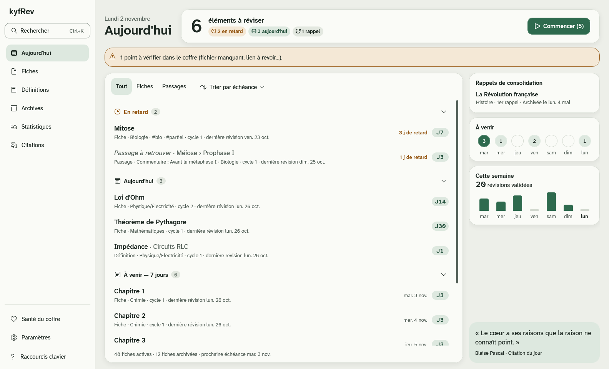
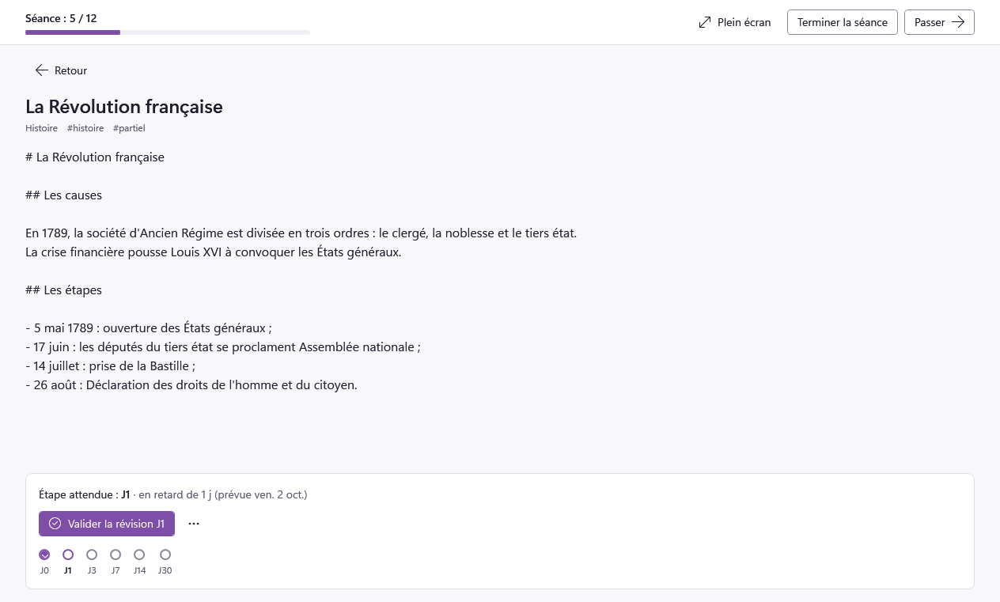

# Design system de kyfRev

`src/KyfRev.DesignSystem` réunit l'identité visuelle de kyfRev, « Veillée », et les composants
WPF qui l'appliquent. Il ne dépend d'aucune autre couche ; la présentation l'emploie, jamais
l'inverse.

Veillée a été choisie en novembre 2026 parmi plusieurs propositions : une interface pensée pour
les longues séances de révision, lisible avant tout (Atkinson Hyperlegible), douce le jour (vert
sauge et forêt) et chaude le soir (un sombre brun plutôt que bleuté), aux formes arrondies sans
être enfantines.


Les captures sont dans [`captures/j5`](captures/j5) : la galerie des composants en
[clair](captures/j5/galerie-clair.png), [sombre](captures/j5/galerie-sombre.png) et
[contraste élevé](captures/j5/galerie-contraste-eleve.png) (avec les couleurs système du poste
qui les a produites), et la coquille ([claire](captures/j5/coquille-clair.png),
[sombre](captures/j5/coquille-sombre.png), [recherche](captures/j5/recherche-sombre.png),
[aide](captures/j5/aide-clair.png)) à chaque largeur de fenêtre
([étroite](captures/j5/coquille-etroite-clair.png),
[étroite avec « Plus »](captures/j5/coquille-etroite-plus-sombre.png),
[aide étroite](captures/j5/aide-etroite-sombre.png),
[moyenne](captures/j5/coquille-moyenne-sombre.png), [large](captures/j5/coquille-large-clair.png)).
`tools/design-captures` les régénère ; la galerie
s'ouvre aussi dans l'application (`kyfRev --galerie`).

## Jetons

### Gammes

Deux gammes de dix nuances (50 à 900), de la plus claire à la plus foncée (`Tokens/Palette.cs`) :

| Gamme | Code | Emploi | Nuances clés |
|---|---|---|---|
| Forêt | `Palette.Forest` | l'action, ce qui est fait, la sélection | 700 `#2e6a4e` (clair), 300 `#86c7a1` (sombre) |
| Ambre | `Palette.Amber` | le retard, l'avertissement, les passages surlignés | 700 `#93540f` (clair), 300 `#eba458` (sombre) |

S'y ajoutent, pour chaque thème, les neutres et les couleurs fonctionnelles : « Jour », clair,
teinté de sauge (fond `#edefe9`, cartes `#fafbf7`), et « Veillée », sombre et chaud (fond
`#191714`, cartes `#24211c`). L'erreur est brique (`#a33a2b`, `#f0a090`), hors des deux gammes,
pour ne jamais se confondre avec un retard. `Palette.cs` est le seul fichier où une couleur
s'écrit : un test refuse toute couleur écrite ailleurs dans l'interface (code ou XAML, valeur
hexadécimale ou couleur nommée).

### Rôles

Les composants n'emploient que des rôles (`ColorRole`, 38 rôles), traduits en couleur par le
thème (`ThemeColors`) :

| Rôle | Clair (Jour) | Sombre (Veillée) | Contraste élevé |
|---|---|---|---|
| `Background`, `Surface`, `SurfaceAlt` | `#edefe9`, `#fafbf7`, `#e3e8e0` | `#191714`, `#24211c`, `#2e2a24` | fenêtre |
| `Text`, `TextSecondary` | `#1d2822`, `#4f5c54` | `#efe9dc`, `#b4ab9b` | texte de fenêtre |
| `Primary` / survol / enfoncé | forêt 700 / 800 / 900 | forêt 300 / 200 / 100 | mise en évidence |
| `OnPrimary` | blanc | `#13201a` | texte mis en évidence |
| `Link`, `Focus` | forêt 700 | forêt 300 | lien, texte de fenêtre |
| `ControlBorder` | `#77837a` | `#877e70` | texte de fenêtre |
| `Divider` (décoratif) | `#d3d9d0` | `#38332b` | texte de fenêtre |
| Repères Fiche, Passage, Rappel | forêt 700, ambre 700, texte secondaire | forêt 300, ambre 300, texte secondaire | texte de fenêtre |
| Pastilles Fiche, Passage | texte 800 sur fond 100 | texte 100 sur fond 900 | texte sur fenêtre |
| `Selection`, `Highlight`, `HighlightActive` | forêt 200, ambre 200, ambre 300 | forêt 800, ambre 800, ambre 700 | mise en évidence |
| `NavigationActiveBackground` | forêt 100 | forêt 900 | mise en évidence |
| `Critical`, `Warning`, `Success`, `Info` | `#a33a2b`, ambre 700, forêt 700, forêt 800 | `#f0a090`, ambre 300, forêt 300, forêt 100 | texte de fenêtre |

### Contrastes

`ContrastRequirements` liste les 51 paires de rôles que les composants emploient : 4,5:1 au
moins pour un texte (WCAG 1.4.3), 3:1 pour un contour ou un repère (1.4.11). Les tests les
vérifient toutes, dans chaque thème :

| Thème | Textes (33 paires) | Contours et repères (18 paires) |
|---|---|---|
| Clair (Jour) | 4,94:1 au moins (retard sur son fond) | 3,18:1 au moins (contour sur `SurfaceAlt`) |
| Sombre (Veillée) | 4,94:1 au moins (texte sur le surlignage actif) | 3,56:1 au moins (contour sur `SurfaceAlt`) |

- Le contour des contrôles (`ControlBorder`) atteint 3:1 sur tous les fonds. Le trait clair des
  séparateurs et des cartes (`Divider`) reste décoratif : il ne porte jamais seul une information.
- En contraste élevé, chaque paire tombe sur une paire de couleurs de Windows dont Windows
  garantit le contraste (texte sur fenêtre, texte mis en évidence sur mise en évidence, lien sur
  fenêtre) ; les ombres disparaissent, les contours restent.
- Un état ne dépend jamais de la seule couleur : chaque pastille et chaque notification porte
  une icône et un libellé, l'élément choisi d'une liste passe en gras.

### Échelles

| Échelle | Valeurs |
|---|---|
| Typographie (taille / interligne) | `Caption` 13/20, `Body` 15/24 (et `BodyStrong`), `BodyLarge` 17/24, `Subtitle` 21/28, `Title` 34/40, `Display` 48/56 |
| Lecture des fiches | 17, 19 ou 21 px, interligne 1,65 (réglage de la 0.x) |
| Polices | Atkinson Hyperlegible Next (interface, titres, fiches) et Atkinson Hyperlegible Mono (étapes, dates, compteurs, code), livrées avec kyfRev ; Segoe Fluent Icons ou Segoe MDL2 Assets (icônes) |
| Espacements | grille de 4 px : 4, 8, 12, 16, 20, 24, 32, 40, 48 |
| Rayons | 12 (contrôles), 20 (cartes, menus), 24 (dialogues) ; pastilles en arrondi complet |
| Élévations | « Card » (ombre douce des cartes), « Flyout » (menus) et « Dialog » ; aucune en contraste élevé |
| Tailles | contrôles de 40 px de haut au moins, 44 pour le bouton principal et les éléments de liste |
| Durées | 120 et 220 ms, décélération douce ; nulles, et squelettes immobiles, si Windows demande de réduire les animations |

### Polices

Les deux familles Atkinson sont livrées dans `src/KyfRev.DesignSystem/Fonts`, en fichiers
statiques (WPF ne choisit pas la graisse d'une police variable), avec leur licence SIL Open
Font License 1.1, copiée dans `Fonts` à côté de l'exécutable compilé, et dans `licences` une
fois l'application installée. Elles viennent des dépôts officiels, à un commit figé :

| Famille | Fichiers | Source |
|---|---|---|
| Atkinson Hyperlegible Next | Regular, Italic, SemiBold, SemiBoldItalic, Bold, BoldItalic | `googlefonts/atkinson-hyperlegible-next` à `7925f50f` |
| Atkinson Hyperlegible Mono | Regular, SemiBold | `googlefonts/atkinson-hyperlegible-next-mono` à `154d5036` |

## Composants

| Composant | Code | Rôle |
|---|---|---|
| Boutons | styles `Kyf.Button` (secondaire, par défaut), `Kyf.Button.Primary`, `Kyf.Button.Subtle`, `Kyf.Button.Icon` | une seule action principale par vue |
| Champ | style de `TextBox`, indication `Field.Placeholder` | contour à 3:1, contour épaissi au focus, indication lue comme aide |
| Mot de passe | style de `PasswordBox` | le même champ, caractères masqués ; pas d'indication dans le champ (son nom, à côté, le dit), et un menu qui ne fait que coller |
| Liste de choix | style de `ComboBox` | comme un champ, et sa liste comme un menu ; suit le thème |
| Carte | `Card`, repère `Marker` (fiche, passage, rappel) | ombre douce ; le repère est un court trait en haut |
| Pastille | `Pill`, sorte `Kind` | icône et libellé : fiche, passage, rappel, retard, archivée, à vérifier, aujourd'hui |
| Menu | styles de `ContextMenu`, `Menu`, `MenuItem` | coche, raccourci, sous-menus ; au clic droit, les actions rapides en tête (`Kyf.MenuItem.Quick`), une rangée d'outils dessous (`Kyf.MenuItem.Tool`), disposées par `ActionMenuPanel` ; les champs de texte reçoivent le leur en se chargeant |
| Listes | styles de `ListBox`, `ListBoxItem` | survol, élément choisi : fond vert pâle et texte en gras (menu de la coquille) |
| Icône | `Icon` | décorative : police d'icônes de Windows, ignorée par le lecteur d'écran |
| Dialogue | `Dialog` | voile, focus tenu à l'intérieur, Échap ferme, Entrée valide ; trop haut pour la fenêtre, son contenu défile entre le titre et les boutons ; ce qui compte (`IsDestructive`) a un bouton rouge, qu'Entrée ne déclenche pas |
| Case à cocher, bouton radio | styles de `CheckBox`, `RadioButton` | la case carrée, le bouton rond ; la couleur principale quand ils sont choisis, le contour épaissi au focus |
| Barre de progression | style de `ProgressBar` | une piste discrète, la part faite à la couleur principale ; nommée pour le lecteur d'écran |
| Notification | `Notification`, gravité `Severity` | annoncée par le lecteur d'écran (tout de suite pour une erreur) |
| État vide | `EmptyState` | icône, titre, explication, action |
| Squelette | `Skeleton` | chargement, immobile si les animations sont réduites |
| Texte | styles `Kyf.Text.*` | l'échelle typographique |

Le focus clavier est toujours visible : un anneau de 2 px décalé de 2 px (`Kyf.FocusVisual`), à
l'intérieur de la ligne dans les listes et les menus (`Kyf.FocusVisual.Inset`), ou
le contour épaissi des champs. Les textes des composants (« Fermer », « Annuler »…) sont lus
dans `Resources/DesignText.resx`.

Chaque composant se présente à UI Automation (lecteurs d'écran, Accessibility Insights) : le
dialogue comme un volet marqué « dialogue » et nommé par son titre, la notification comme un
groupe annoncé dès qu'il paraît, la pastille et le squelette comme un texte, l'état vide comme un
groupe nommé par son titre et décrit par son explication. Les composants qui ne s'actionnent pas
ne prennent pas le focus.

## Coquille

`KyfRev.Presentation.Wpf` assemble ces composants dans la fenêtre de l'application :

| Élément | Clavier | Rôle |
|---|---|---|
| Menu | flèches, Tab | les vues de la 0.x dans le même ordre, celles des modules actifs à leur rang, Santé du coffre et Paramètres en bas |
| Recherche de commandes | Ctrl+K | aller à une vue, changer de thème, de zoom ou de mode ; sans tenir compte des accents ni de la casse |
| Aide | F1 | les raccourcis clavier |
| Mode concentration | Ctrl+Maj+F | masque le menu |
| Zoom | Ctrl+plus, Ctrl+moins, Ctrl+0 | de 80 à 200 %, par pas de 10 % |
| Vues du menu | Ctrl+1 à Ctrl+9 | les neuf premières vues |

Le menu suit la largeur de la fenêtre, divisée par le zoom (`ShellLayout`) : agrandir
l'interface revient à rétrécir la fenêtre. Le contenu ne défile jamais horizontalement, seulement
verticalement.

| Largeur | Menu |
|---|---|
| moins de 600 px (téléphone, fenêtre ancrée sur un tiers d'écran) | le nom, la recherche et l'aide en haut ; les trois premières vues en onglets en bas, les autres (et Santé du coffre, Paramètres) sous « Plus » |
| de 600 à 1 399 px (tablette, portable, demi-écran) | une colonne d'icônes de 112 px, chaque libellé sous son icône |
| 1 400 px et plus (écran, écran large) | la barre latérale de 248 px : nom, recherche avec Ctrl+K, libellés à côté des icônes |

Le thème suit Windows (clair ou sombre, barre de titre comprise) ou le choix fait dans la
recherche ou dans la galerie ; le contraste élevé de Windows passe avant tout choix, et un
changement dans Windows s'applique sans redémarrage. Les vues encore à porter présentent ce
qu'elles feront.

Les règles automatiques d'Accessibility Insights (FastPass) sont appliquées par Axe.Windows à
l'application lancée pour de vrai : chaque vue, l'aide et la recherche, en clair et en sombre,
sans aucune erreur (`tests/KyfRev.Presentation.Wpf.Tests`).


## Aujourd'hui

La vue d'ouverture suit la largeur de sa page, zoom et menu déjà comptés :

| Largeur de la page | Disposition |
|---|---|
| moins de 600 px | une colonne ; le résumé sous le titre, le bouton de séance sur toute la largeur ; le tri réduit à son icône, le retard sous le titre de la ligne, pas de pied de liste |
| de 600 à 879 px | une colonne ; les boutons de séance dans le résumé |
| de 880 à 1 549 px | le résumé à côté du titre ; la liste et une colonne latérale de 340 px |
| de 1 550 à 2 149 px | s'y ajoute l'aperçu de la ligne choisie, sur 620 px |
| 2 150 px et plus | la liste en deux cartes (retards et rappels ; aujourd'hui et à venir), un aperçu de 840 px, 14 jours à venir |

La colonne latérale montre les rappels de consolidation, les échéances des sept prochains jours,
les révisions validées ces sept derniers jours et, ancrés en bas, les encarts des modules. Sans
elle, les rappels restent dans la liste et le reste défile à sa suite : la liste reste
virtualisée. Une carte sans rien à montrer n'apparaît pas : aucun contenu de remplissage.

Avec l'aperçu, un clic choisit la ligne et un double clic, Entrée ou « Réviser maintenant » l'ouvre.
L'aperçu montre le texte d'une fiche, les étapes de son cycle et ce qui a été révisé ; un passage
caché ou une définition n'y dévoile rien : seule la révision le montre.

Le graphique de la semaine n'a qu'une série : une couleur, des barres fines ancrées en bas, un
trait discret pour un jour sans révision, les jours écrits dessous. Chaque jour donne sa valeur
au survol et au lecteur d'écran.



## Révision

Une fiche ou un passage se lit au centre de la page, sur 720 px au plus. La barre de révision reste
visible en bas, centrée, sur 980 px au plus : la frise des étapes, l'étape attendue et son échéance,
« Reporter », les autres actions et « Valider ». Sous 720 px de page, ces éléments passent l'un
sous l'autre. En séance, la progression occupe toute la largeur en haut de la page ; sous 560 px,
les boutons de la séance passent sous elle.

Quand un rappel de consolidation attend sa réponse, la barre propose les trois réponses à la place
de la frise : « Fiche connue » en bouton principal, « Certains points sont à revoir » et « Fiche à
revoir entièrement… ». Pour les points à revoir, les passages de la fiche s'affichent dans la
barre, chacun avec « Remettre à J0 », le compte des passages marqués, « Annuler » et « Terminer ».



## Icône

Un éventail de fiches, du vert à l'ambre ; la fiche du dessus est écrite, surlignée, et porte sa
frise. Pour Windows, l'icône a les couleurs du thème clair, sans fond : les fiches occupent toute
sa surface, et un liseré ivoire les détache sur les fonds clairs comme sombres. Elle se simplifie
à mesure qu'elle rapetisse : la frise se réduit à trois ronds à 48 px (l'étape validée, celle à
réviser, la prochaine), les lignes s'épaississent à 32 px, la frise disparaît à 16 px.

`assets/icon/kyfrev.svg` en est la source unique : `tools/icon/icon.cs` en génère le `.ico` et les
images de l'installateur (voir `assets/icon/README.md`). Une version avec fond, ivoire ou forêt, est
gardée pour une éventuelle application mobile ou macOS.


## Emploi

```csharp
var design = new DesignResources(ThemeKind.Light, Motion.SystemPrefersReducedMotion);
Application.Current.Resources.MergedDictionaries.Add(design.Dictionary);
design.Theme = ThemeKind.Dark;   // l'interface suit, sans rechargement
```

Les styles nomment leurs ressources par `DesignKeys` (`Kyf.Brush.Primary`, `Kyf.FontSize.Body`…),
toujours en `DynamicResource` pour suivre le thème.
