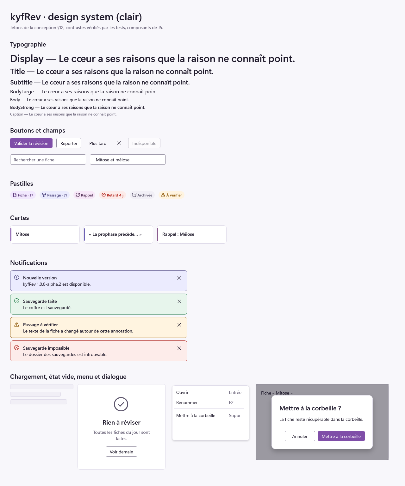
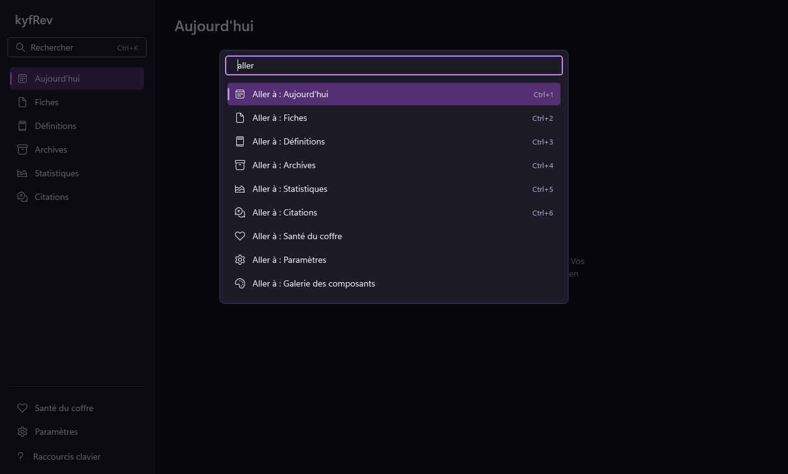

# Design system de kyfRev

`src/KyfRev.DesignSystem` réunit l'identité visuelle de kyfRev (conception de la 0.x, §12) et
les composants WPF qui l'appliquent. Il ne dépend d'aucune autre couche ; la présentation
l'emploie, jamais l'inverse.



Les captures sont dans [`captures/j5`](captures/j5) : la galerie des composants en
[clair](captures/j5/galerie-clair.png), [sombre](captures/j5/galerie-sombre.png) et
[contraste élevé](captures/j5/galerie-contraste-eleve.png) (avec les couleurs système du poste
qui les a produites), et la coquille ([claire](captures/j5/coquille-clair.png),
[sombre](captures/j5/coquille-sombre.png), [recherche](captures/j5/recherche-sombre.png),
[aide](captures/j5/aide-clair.png)). `tools/design-captures` les régénère ; la galerie
s'ouvre aussi dans l'application (`kyfRev --galerie`).

## Jetons

### Gammes

Trois gammes de dix nuances (50 à 900), construites dans l'espace OKLCH autour des quatre
couleurs fournies, conservées telles quelles (`Tokens/Palette.cs`) :

| Gamme | Code | Couleurs fournies |
|---|---|---|
| Violet (principale) | `Palette.Violet` | 600 `#7f4ea8` |
| Pervenche (secondaire : passages, sélection) | `Palette.Periwinkle` | 400 `#9c93e5` |
| Mauve (accent : rappels, surlignage) | `Palette.Mauve` | 400 `#ba8cbe`, 300 `#c7a3d2` |

S'y ajoutent, pour chaque thème, les neutres teintés de violet et les couleurs fonctionnelles
(retard, avertissement, réussite), volontairement hors de la famille violette. `Palette.cs` est le
seul fichier où une couleur s'écrit : un test refuse toute couleur écrite ailleurs dans
l'interface (code ou XAML, valeur hexadécimale ou couleur nommée).

### Rôles

Les composants n'emploient que des rôles (`ColorRole`, 38 rôles), traduits en couleur par le
thème (`ThemeColors`) :

| Rôle | Clair | Sombre | Contraste élevé |
|---|---|---|---|
| `Background`, `Surface`, `SurfaceAlt` | `#f8f7fb`, `#ffffff`, `#f1eff6` | `#15121c`, `#1e1a28`, `#2a2536` | fenêtre |
| `Text`, `TextSecondary` | `#221d2e`, `#5d566d` | `#ece8f4`, `#a9a1bb` | texte de fenêtre |
| `Primary` / survol / enfoncé | violet 600 / 700 / 800 | violet 400 / 300 / 200 | mise en évidence |
| `OnPrimary` | blanc | `#15121c` | texte mis en évidence |
| `Link`, `Focus` | violet 600 | violet 300, violet 400 | lien, texte de fenêtre |
| `ControlBorder` | `#8a8498` | `#777087` | texte de fenêtre |
| `Divider` (décoratif) | `#dedae8` | `#3a3448` | texte de fenêtre |
| Repères Fiche, Passage, Rappel | nuances 600 | nuances 400 | texte de fenêtre |
| Pastilles Fiche, Passage, Rappel | texte 800 sur fond 100 | texte 100 sur fond 800 | texte sur fenêtre |
| `Selection`, `Highlight`, `HighlightActive` | pervenche 200, mauve 200, mauve 300 | pervenche 800, mauve 800, mauve 700 | mise en évidence |
| `Critical`, `Warning`, `Success`, `Info` | `#b3261e`, `#8a5300`, `#1e7a46`, pervenche 800 | `#ff8a80`, `#f0b45a`, `#6fcf97`, pervenche 100 | texte de fenêtre |

### Contrastes

`ContrastRequirements` liste les 51 paires de rôles que les composants emploient : 4,5:1 au
moins pour un texte (WCAG 1.4.3), 3:1 pour un contour ou un repère (1.4.11). Les tests les
vérifient toutes, dans chaque thème :

| Thème | Textes (33 paires) | Contours et repères (18 paires) |
|---|---|---|
| Clair | 4,75:1 au moins (réussite sur son fond) | 3,16:1 au moins (contour sur `SurfaceAlt`) |
| Sombre | 6,00:1 au moins (texte secondaire sur `SurfaceAlt`) | 3,14:1 au moins (contour sur `SurfaceAlt`) |

- Le contour des contrôles (`ControlBorder`) remplace la bordure à 1,29:1 de la 0.x, qui
  rendait les champs difficiles à repérer. Le trait clair d'autrefois reste celui des séparateurs
  et des cartes (`Divider`), décoratif : il ne porte jamais seul une information.
- En contraste élevé, chaque paire tombe sur une paire de couleurs de Windows dont Windows
  garantit le contraste (texte sur fenêtre, texte mis en évidence sur mise en évidence, lien sur
  fenêtre) ; les ombres disparaissent.
- Un état ne dépend jamais de la seule couleur : chaque pastille et chaque notification porte
  une icône et un libellé.

### Échelles

| Échelle | Valeurs |
|---|---|
| Typographie (taille / interligne) | `Caption` 12/16, `Body` 14/20 (et `BodyStrong`), `BodyLarge` 16/24, `Subtitle` 20/28, `Title` 24/32, `Display` 32/40 |
| Lecture des fiches | 17, 19 ou 21 px, interligne 1,65 (réglage de la 0.x) |
| Polices | Segoe UI Variable (interface et titres), Cascadia Mono ou Consolas (code), Segoe Fluent Icons ou Segoe MDL2 Assets (icônes) |
| Espacements | grille de 4 px : 4, 8, 12, 16, 20, 24, 32, 40, 48 |
| Rayons | 4 (contrôles), 8 (cartes, menus), 12 (dialogues) |
| Élévations | « Flyout » (menus) et « Dialog » ; tout le reste est à plat, bordé d'un trait de 1 px |
| Durées | 100 et 150 ms ; nulles, et squelettes immobiles, si Windows demande de réduire les animations |

## Composants

| Composant | Code | Rôle |
|---|---|---|
| Boutons | styles `Kyf.Button` (secondaire, par défaut), `Kyf.Button.Primary`, `Kyf.Button.Subtle`, `Kyf.Button.Icon` | une seule action principale par vue |
| Champ | style de `TextBox`, indication `Field.Placeholder` | contour à 3:1, contour épaissi au focus, indication lue comme aide |
| Carte | `Card`, repère `Marker` (fiche, passage, rappel) | barre latérale de 3 px |
| Pastille | `Pill`, sorte `Kind` | icône et libellé : fiche, passage, rappel, retard, archivée, à vérifier |
| Menu | styles de `ContextMenu`, `Menu`, `MenuItem` | coche, raccourci, sous-menus |
| Listes | styles de `ListBox`, `ListBoxItem` | survol, élément choisi : fond 100 et barre latérale de 3 px (menu de la coquille) |
| Icône | `Icon` | décorative : police d'icônes de Windows, ignorée par le lecteur d'écran |
| Dialogue | `Dialog` | voile, focus tenu à l'intérieur, Échap ferme, Entrée valide |
| Notification | `Notification`, gravité `Severity` | annoncée par le lecteur d'écran (tout de suite pour une erreur) |
| État vide | `EmptyState` | icône, titre, explication, action |
| Squelette | `Skeleton` | chargement, immobile si les animations sont réduites |
| Texte | styles `Kyf.Text.*` | l'échelle typographique |

Le focus clavier est toujours visible : un anneau de 2 px décalé de 2 px (`Kyf.FocusVisual`), ou
le contour épaissi des champs. Les textes des composants (« Fermer », « Annuler »…) sont lus
dans `Resources/DesignText.resx`.

Chaque composant se présente à UI Automation (lecteurs d'écran, Accessibility Insights) : le
dialogue comme un volet marqué « dialogue » et nommé par son titre, la notification comme un
groupe annoncé dès qu'il paraît, la pastille et le squelette comme un texte, l'état vide comme un
groupe nommé par son titre et décrit par son explication. Les composants qui ne s'actionnent pas
ne prennent pas le focus.

## Coquille

`KyfRev.Presentation.Wpf` assemble ces composants dans la fenêtre de l'application :

| Élément | Clavier | Rôle |
|---|---|---|
| Menu latéral | flèches, Tab | les vues de la 0.x dans le même ordre, celles des modules actifs à leur rang, Santé du coffre et Paramètres en bas |
| Recherche de commandes | Ctrl+K | aller à une vue, changer de thème, de zoom ou de mode ; sans tenir compte des accents ni de la casse |
| Aide | F1 | les raccourcis clavier |
| Mode concentration | Ctrl+Maj+F | masque le menu |
| Zoom | Ctrl+plus, Ctrl+moins, Ctrl+0 | de 80 à 200 %, par pas de 10 % |
| Vues du menu | Ctrl+1 à Ctrl+9 | les neuf premières vues |

Le thème suit Windows (clair ou sombre, barre de titre comprise) ou le choix fait dans la
recherche ou dans la galerie ; le contraste élevé de Windows passe avant tout choix, et un
changement dans Windows s'applique sans redémarrage. Les vues encore à porter présentent ce
qu'elles feront.

Les règles automatiques d'Accessibility Insights (FastPass) sont appliquées par Axe.Windows à
l'application lancée pour de vrai : chaque vue, l'aide et la recherche, en clair et en sombre,
sans aucune erreur (`tests/KyfRev.Presentation.Wpf.Tests`).



## Emploi

```csharp
var design = new DesignResources(ThemeKind.Light, Motion.SystemPrefersReducedMotion);
Application.Current.Resources.MergedDictionaries.Add(design.Dictionary);
design.Theme = ThemeKind.Dark;   // l'interface suit, sans rechargement
```

Les styles nomment leurs ressources par `DesignKeys` (`Kyf.Brush.Primary`, `Kyf.FontSize.Body`…),
toujours en `DynamicResource` pour suivre le thème.
